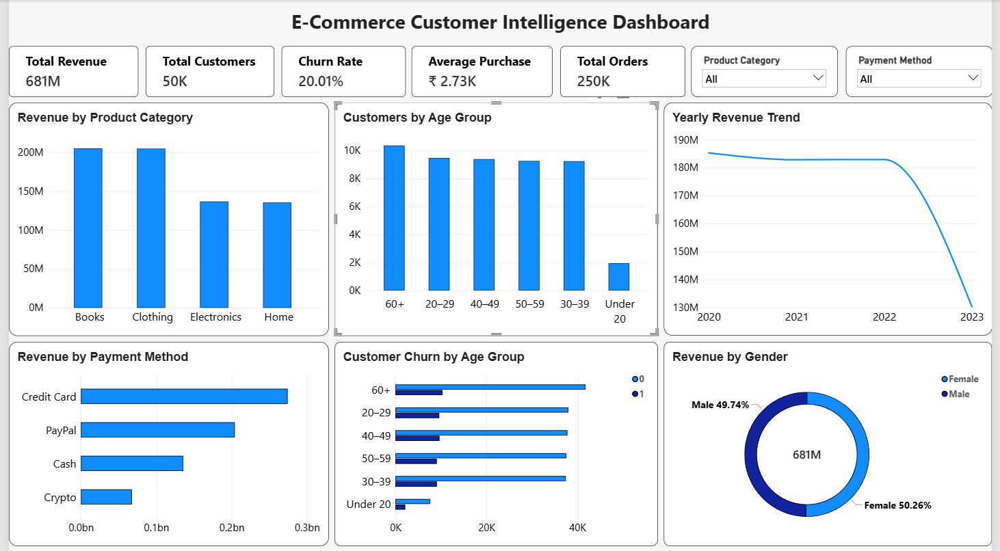

# E-Commerce Customer Intelligence System

## Dashboard Preview



## Project Overview

The **E-Commerce Customer Intelligence System** analyzes customer purchasing behavior, sales performance, customer segmentation, and churn patterns.

Python is used for data cleaning, exploratory data analysis, and customer segmentation. Power BI is used to create an interactive dashboard that presents key business insights.

> **Dataset note:** This project uses a simulated e-commerce customer behavior dataset. The original raw dataset is not included in this repository because of its large file size.

## Project Objectives

- Analyze revenue and purchasing patterns.
- Understand customer behavior and demographics.
- Perform RFM-based customer segmentation.
- Explore customer churn patterns.
- Build an interactive Power BI dashboard.

## Tools and Technologies

- Python
- Pandas and NumPy
- Matplotlib and Seaborn
- Jupyter Notebook
- Power BI
- DAX

## Project Workflow

1. Load and inspect the dataset.
2. Clean the data and remove duplicate records.
3. Perform exploratory data analysis (EDA).
4. Analyze revenue by product category and payment method.
5. Perform RFM-based customer segmentation.
6. Analyze customer churn.
7. Build an interactive Power BI dashboard.

## Power BI Dashboard

### Key Performance Indicators

- Total Revenue
- Total Customers
- Churn Rate
- Average Purchase
- Total Orders

### Dashboard Visualizations

- Revenue by Product Category
- Customer Count by Age Group
- Yearly Revenue Trend
- Revenue by Payment Method
- Customer Churn by Age Group
- Revenue by Gender

### Interactive Filters

- Product Category
- Payment Method

## Dataset Information

The dataset includes customer and purchase-related fields such as:

`Customer ID`, `Purchase Date`, `Product Category`, `Product Price`, `Quantity`, `Total Purchase Amount`, `Payment Method`, `Customer Age`, `Returns`, `Gender`, and `Churn`.

The raw dataset is excluded from this repository due to its size. The processed data files are available in the `Data/Processed` folder.

## Key Analysis

This project explores:

- Which product categories generate the most revenue.
- How revenue varies across payment methods.
- How customer churn varies across age groups.
- How revenue changes over time.
- How revenue is distributed by gender.
- How customers can be grouped using RFM analysis.

## Repository Structure

```text
E-Commerce-Customer-Intelligence/
│
├── Dashboard/
│   ├── E-Commerce Customer Intelligence Dashboard.pbix
│   └── dashboard.png
│
├── Data/
│   └── Processed/
│       ├── cleaned_customer_data.csv
│       ├── customer_segmentation.csv
│       └── churn_analysis.csv
│
├── notebooks/
│   └── Data_Inspection.ipynb
│
└── README.md
```

## How to Run

1. Clone or download this repository.
2. Open the Jupyter Notebook in the `notebooks` folder.
3. Obtain the original dataset from the source used for this project.
4. Place the raw dataset in the appropriate local data folder.
5. Update the dataset path in the notebook if required.
6. Run the notebook cells to reproduce the analysis.
7. Open the `.pbix` file using Power BI Desktop to explore the dashboard.

## Disclaimer

This project uses a simulated dataset and is intended for educational and portfolio purposes. The findings should not be interpreted as actual business results.
